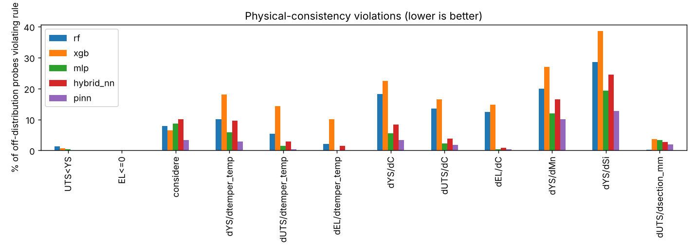

# PIM: Physics-Informed Inverse Design of Steels

This project implements the research plan *"AI-Driven Inverse Material Design of Steel and
Iron-Based Alloys Using Physics-Informed Machine Learning"*. The workflow is:

1. **Forward model.** Predict yield strength, tensile strength and elongation from chemical
   composition and processing. Hardness is estimated.
2. **Physics-informed learning.** Metallurgical relations act as descriptors, hard constraints
   and soft loss terms.
3. **Inverse design.** NSGA-II searches for the composition and heat treatment that meet target
   properties, and favours candidates with low uncertainty that lie inside the data's
   applicability domain.
4. **Validation.** Composition-grouped cross-validation, physical-consistency probes and an
   external dataset.

## Data

| Dataset | Records | Use | Source |
|---|---|---|---|
| Birbilis, Ghorbani & Zhao (2025), *A Database of Mechanical Properties of Steels* | 3,234 raw → **1,830 unique** | Training / CV | Mendeley Data, [doi:10.17632/jmwb9ddd43.1](https://doi.org/10.17632/jmwb9ddd43.1), CC BY 4.0 |
| Citrine `steel_strength` (via Matminer) | 312 | External test | figshare file 13354691 |

Both raw files are in `data/raw/`. Running `python scripts/download_data.py` downloads them again
and checks their SHA-256 hashes.

**Audit findings** (`results/data_audit.json`):

* **1,403 of the 3,234 rows (43 %) are exact duplicates** (same composition, processing and
  properties) and were removed. The remaining 1,830 records come from only **345 distinct
  compositions**. Every split is therefore grouped by composition, because random splits leak
  information.
* Processing is free text. `data.parse_processing` turns it into route flags (quenched, oil or
  water, tempered, normalised, annealed, carburised, cold drawn, …), the austenitising
  temperature, the tempering temperature and the section size. Each imputed value gets a missing
  flag.
* **Neither dataset has hardness labels.** HV is estimated from UTS (HV ≈ UTS/3.3) and is always
  labelled as an estimate.
* About 90 % of the records satisfy the Hollomon + Considère bound used as a soft constraint
  (`results/figures/considere_bound.png`).

## Method

The relations are listed below. Equations and references are in [`docs/physics.md`](docs/physics.md).

* **Differentiable physics-descriptor layer** inside the network: Andrews Ms,
  Koistinen–Marburger martensite fraction, Hollomon–Jaffe tempering parameter, IIW carbon
  equivalent and Pickering solid-solution increment.
* **Hard constraints** built into the architecture: UTS = YS + softplus(·) ≥ YS, and EL, HV > 0.
* **Soft physics loss** on unlabelled collocation points, phased in after data pre-training:
  * tempering softening (∂σ/∂T_temper ≤ 0, ∂EL/∂T_temper ≥ 0)
  * carbon and solid-solution strengthening (∂YS/∂C, ∂YS/∂Mn, ∂YS/∂Si, ∂YS/∂P ≥ 0, ∂EL/∂C ≤ 0)
  * the quench mass effect (∂UTS/∂section ≤ 0)
  * the Hollomon + Considère inequality YS/UTS ≥ r_min(EL)
  * Tabor hardness consistency
* **Multi-task network:** shared trunk of 128-128-64 SiLU layers, with strength, hardness and
  ductility heads.
* **Deep ensemble** of 5 members for uncertainty. A k-NN **applicability domain** (95th
  percentile of training distances) flags extrapolation.
* **NSGA-II (pymoo).** It optimises C, Mn, Si, Cr, Ni, Mo, V, the austenitising temperature and
  the tempering temperature for an oil-quench-and-temper route. The objectives are maximum UTS,
  maximum EL and minimum uncertainty. The constraints are the property targets plus the
  applicability domain. Search bounds are the 1st–99th percentiles of the oil-Q&T records in the
  data.

## Results

### Grouped 5-fold CV (`results/cv_summary.csv`)

| Model | R² YS | R² UTS | R² EL | MAE YS (MPa) | MAE UTS (MPa) | Physics violations (off-distribution) |
|---|---|---|---|---|---|---|
| Random forest | 0.877 | 0.884 | 0.772 | 59 | 62 | 10.0 % |
| **XGBoost** | **0.890** | **0.900** | **0.823** | 59 | 58 | 14.4 % |
| Plain MLP | 0.703 | 0.790 | 0.780 | 85 | 75 | 5.0 % |
| Hybrid NN (descriptors + hard constraints, no physics loss) | 0.817 | 0.858 | 0.787 | 73 | 66 | 6.7 % |
| **PINN** (hybrid NN + physics loss) | 0.811 | 0.856 | 0.786 | 75 | 68 | **3.1 %** |



**What the results show:**

* **XGBoost is the most accurate point predictor** on held-out compositions. The PINN does
  *not* beat it on R².
* **The PINN is the most physically consistent model.** Its rate of rule violations on perturbed
  off-distribution inputs is 3.1 %, against 14.4 % for XGBoost and 6.7 % for the same network
  without the physics loss. The physics loss lowers violations of every rule and costs almost
  no accuracy compared with the hybrid NN.
* This is why the PINN ensemble drives the inverse design. An optimiser searches exactly the
  off-distribution regions where unconstrained models break physical trends, for example
  strength that rises with tempering temperature.

### External validation (`results/external_validation.json`)

The Matminer set contains maraging and secondary-hardening steels (YS 1,000–2,500 MPa, high Co,
Ni and Ti, no processing information). This chemistry is absent from the training data, and
**all 312 records fall outside the applicability domain**. Both models fail on this set: R² for
YS is −4.9 for the PINN and −3.0 for XGBoost. This is a negative result, and it shows that the
models do not transfer to a different steel class. The domain check correctly flags every one of
these records.

### Inverse design example (`results/candidates.csv`)

Targets: YS ≥ 800 MPa, UTS ≥ 1,000 MPa, HV ≥ 300, EL ≥ 12 %. Route: oil quench and temper,
25 mm section.

| # | C | Mn | Si | Cr | Ni | Mo | V | T_aus (°C) | T_temper (°C) | YS (MPa) | UTS (MPa) | HV* | EL (%) |
|---|---|---|---|---|---|---|---|---|---|---|---|---|---|
| 1 | 0.41 | 0.62 | 0.58 | 1.15 | 2.17 | 0.28 | 0.04 | 798 | 569 | 1174 ± 24 | 1240 ± 20 | 366 | 15.1 ± 0.4 |
| 2 | 0.41 | 0.66 | 0.52 | 1.19 | 0.51 | 0.28 | 0.02 | 798 | 567 | 1061 ± 11 | 1137 ± 6 | 339 | 16.3 ± 0.3 |
| 3 | 0.44 | 0.67 | 0.60 | 1.18 | 1.93 | 0.27 | 0.04 | 812 | 622 | 1120 ± 5 | 1182 ± 3 | 347 | 16.3 ± 0.7 |
| 4 | 0.44 | 0.71 | 0.34 | 0.95 | 0.29 | 0.28 | 0.02 | 793 | 600 | 979 ± 7 | 1062 ± 4 | 319 | 17.3 ± 0.2 |
| 5 | 0.45 | 0.82 | 0.46 | 1.22 | 0.10 | 0.29 | 0.03 | 794 | 602 | 1047 ± 7 | 1112 ± 8 | 328 | 16.8 ± 0.4 |

\*HV is estimated from UTS. ± values are the ensemble standard deviation, which measures
epistemic spread only and is **not** a calibrated confidence interval.

The candidates look like Cr–Mo and Ni–Cr–Mo quenched-and-tempered steels (4140/4340 family),
which is metallurgically sensible. They are **computational suggestions, not validated alloys**.
The next step in the proposal is laboratory validation: melting, OES chemistry check, heat
treatment, tensile testing (ISO 6892-1 / ASTM E8) and hardness testing (ISO 6507 / ASTM E92).

## Usage

```bash
pip install -r requirements.txt
```

```bash
./scripts/run_all.sh
```

`run_all.sh` downloads, prepares, benchmarks, trains and runs inverse design. With 4 CPUs it
takes about 15 minutes.

The steps can also be run one at a time:

```bash
python scripts/download_data.py
```

```bash
python scripts/prepare_data.py
```

```bash
python scripts/benchmark_models.py
```

```bash
python scripts/train_final.py
```

```bash
python scripts/run_inverse_design.py --ys 800 --uts 1000 --hv 300 --el 12
```

Predict the properties of one steel:

```bash
python scripts/predict.py --comp C=0.40 Mn=0.7 Si=0.25 Cr=0.8 Ni=1.8 Mo=0.25 --route oil_qt --temper 540
```

Run the tests:

```bash
python -m pytest -q tests
```

## Layout

```
data/raw/                 downloaded datasets (checksummed)
data/processed/           cleaned tables with parsed processing columns
src/steel_pinn/
  config.py               paths, element list, targets
  data.py                 loading, cleaning, processing-text parser, feature builder
  physics.py              Ms, Koistinen–Marburger, Hollomon–Jaffe, CE, solid solution, Hollomon/Considère, HV
  models.py               PhysicsDescriptorLayer, PlainMLP, PhysicsInformedNet
  losses.py               masked data loss + physics losses
  training.py             tree baselines, NN training (2-stage), deep ensemble
  evaluation.py           metrics, grouped CV, physical-consistency probes
  inverse_design.py       applicability domain, NSGA-II problem, candidate shortlist
scripts/                  pipeline entry points
results/                  metrics, figures, trained ensemble, candidates
docs/physics.md           equations and assumptions
```

## Limitations

* There are no hardness labels, so HV is a conversion estimate. There is no grain size, so
  Hall–Petch is not used. Tempering time is assumed to be 1 h.
* The processing text parser relies on rules. About half of the records have no stated
  austenitising temperature, and those values are imputed and flagged.
* Only 345 distinct compositions exist, so the designs stay close to known low-alloy steel
  families. The models do not extrapolate to other steel classes (see the external validation).
* Ensemble uncertainty is not calibrated.
